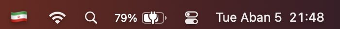

# FlagInput

<p align="center">
  
</p>

<p align="center">Country flags, back in your Mac's menu bar.</p>

<p align="center">
  
</p>

macOS used to show a colored country flag for the active keyboard input source. Since macOS 12.4 the
input menu only shows abbreviations such as `EN` or `ف`. FlagInput is a tiny menu bar app that brings
the flags back — and works with any keyboard layout you have installed, not just a fixed pair of
languages.

## Features

- Shows the flag of the active input source in the menu bar (Iran, United States, United Kingdom,
  Germany, France, … with a 🌐 fallback for uncommon layouts).
- Click the flag to switch between your enabled keyboard layouts.
- Updates immediately when you switch with `⌃Space`, Caps Lock, or any other shortcut.
- Optional **Launch at Login**.
- No network access, no special permissions, no data collection.
- Plain Swift/AppKit, no third-party dependencies.

## Requirements

macOS 13 or later.

## Install

1. Download `FlagInput-1.0.0.zip` from the [latest release](https://github.com/m38d1/flag-input/releases/latest).
2. Unzip it and move `FlagInput.app` to `/Applications`.
3. The build is ad-hoc signed, so Gatekeeper may block it on first launch. Right-click the app and
   choose **Open**, or remove the quarantine attribute:

   ```sh
   xattr -dr com.apple.quarantine /Applications/FlagInput.app
   ```

4. Launch FlagInput. The flag of the current input language appears in the menu bar.
5. Optional: to avoid two indicators, hide the built-in input menu in **System Settings → Keyboard →
   Input Sources → Edit… → Show Input menu in menu bar**.

## Build from source

Requires the Xcode Command Line Tools.

```sh
git clone https://github.com/m38d1/flag-input.git
cd flag-input
./build.sh
```

`build.sh` compiles the app, generates the icon, ad-hoc signs the bundle, and installs it to
`/Applications` (or `~/Applications` if `/Applications` is not writable).

## How it works

FlagInput uses the Carbon Text Input Sources API (`TISCreateInputSourceList`, `TISSelectInputSource`)
to list and switch keyboard layouts. It listens for the system input-source change notification and
also polls once a second as a fallback. The app runs as a menu bar agent (`LSUIElement`) and keeps no
state beyond the chosen menu bar position.

## فارسی

نشانگر پرچم زبان کیبورد در نوار منوی مک. از macOS 12.4 پرچم‌های رنگی از منوی ورودی حذف شدند؛ این
اپ کوچک آن‌ها را برمی‌گرداند و با همهٔ زبان‌های نصب‌شده کار می‌کند. روی پرچم کلیک کن تا زبان را عوض
کنی؛ گزینهٔ «Launch at Login» هم در منو هست. بدون دسترسی خاص، بدون شبکه و بدون جمع‌آوری داده.

## License

MIT — see [LICENSE](LICENSE).
